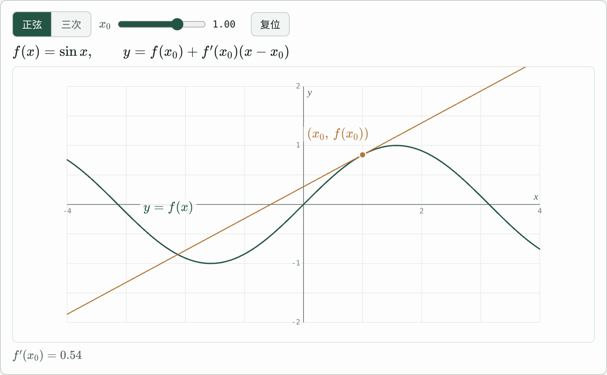
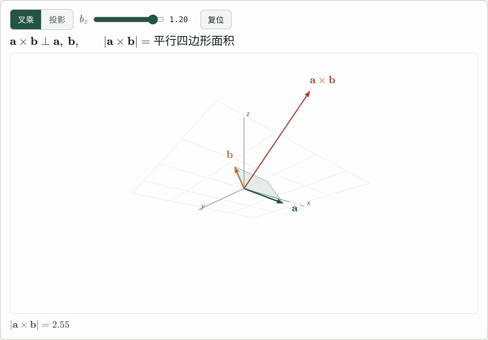
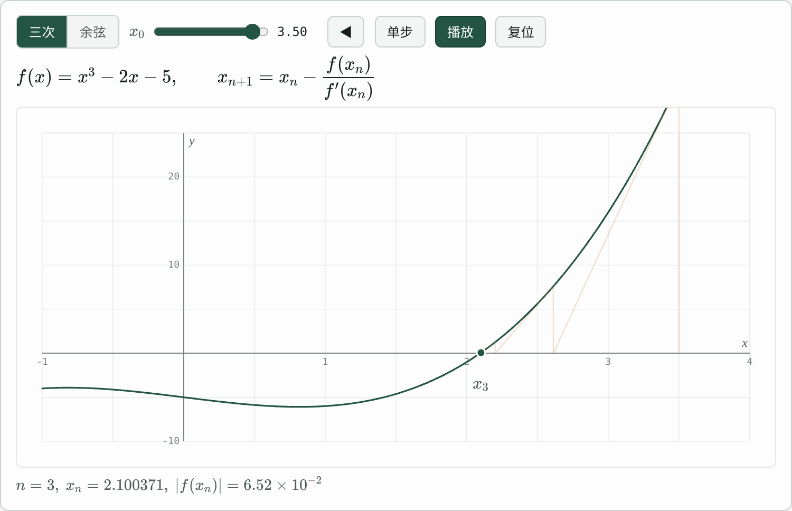

# visual_content_skill

给 AI agent 用的数学交互可视化 skill：面向课程页嵌入的函数图、三维向量、迭代过程等交互模块，风格统一、简约，数学符号全部 KaTeX。

| plane2d | space3d | trace |
|---|---|---|
|  |  |  |

## 组成

- `SKILL.md`：agent 入口，流程与硬约束
- `lib/mathviz-kit.js`：运行时内核（无构建、无依赖），含主题、高清画布、自适应采样、三维相机、KaTeX 标签自动避让、动画与回放
- `templates/`：三种骨架 `plane2d` / `space3d` / `trace`
- `scripts/`：脚手架、规范检查、浏览器渲染验收、预览服务器
- `references/`：规范细节与内核 API 速查

## 快速开始

需要 Node 18+。

```bash
node scripts/new-module.mjs newton-method --kind trace --title 牛顿迭代
node scripts/serve.mjs          # 打开 http://127.0.0.1:5173/examples/newton-method/
node scripts/lint-module.mjs examples/newton-method/index.html
```

浏览器渲染验收（截图、遮挡、DPR、KaTeX、控制台错误、控件冒烟）：

```bash
npm i -D playwright katex && npx playwright install chromium
node scripts/check-render.mjs examples/newton-method/index.html --states states.json
```

单测：`npm test`。

## 作为 skill 使用

把整个文件夹放进 agent 的 skills 目录，或让 agent 先读 `SKILL.md`。
